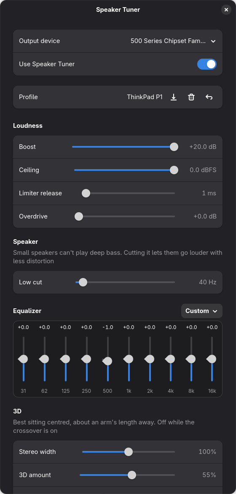

# Speaker Tuner

A small GNOME app that makes laptop and desktop speakers sound better on Linux.



It adds a virtual output, **Speaker Tuner**, in front of any PipeWire sink. All
processing runs inside PipeWire itself (a `filter-chain` module), so there's no
app to keep open, and changes apply live while music is playing.

## Features

- **Low cut**: a 4th-order high-pass that keeps small speakers from wasting
  power on bass they can't play, so they get louder with less distortion.
- **10-band equalizer** (31 Hz to 16 kHz, ±12 dB) with presets.
- **Boost + limiter**: up to +20 dB of gain into a look-ahead limiter
  (ZaMaximX2), with an adjustable ceiling.
- **Overdrive**: gain after the limiter. Above 0 dB it deliberately clips, for
  maximum loudness at the cost of distortion.
- **Stereo width**: mid/side widening from mono (0%) to extra-wide (200%).
- **3D**: crosstalk cancellation in the style of Ambiophonics/RACE. Each
  speaker plays a delayed, inverted, band-limited copy of the other channel,
  so sound appears to come from beyond the speakers. Works best sitting
  centred in front of closely spaced speakers, such as a laptop's.
- **Virtual crossover**: mixes to mono and sends the lows to one speaker and
  the highs to the other (Linkwitz-Riley, 24 dB/oct), with per-speaker levels.
- **Profiles**: save, name, load and delete settings. Reset to defaults any time.

## Requirements

- PipeWire with `pipewire-pulse` and WirePlumber (the default on most current
  distros), plus `pw-cli`, `pw-dump` and `pactl`.
- Python 3 with GObject introspection, GTK 4 and libadwaita 1.5 or newer.
- The **ZaMaximX2** LV2 plugin from [zam-plugins](https://github.com/zamaudio/zam-plugins).
- PipeWire's **LV2 support for filter-chain**. Since PipeWire 1.4 some distros
  package it separately.

| Distro | Packages |
|---|---|
| Fedora | `python3-gobject gtk4 libadwaita lv2-zam-plugins pipewire-module-filter-chain-lv2` |
| Debian / Ubuntu | `python3-gi gir1.2-gtk-4.0 gir1.2-adw-1 zam-plugins` |
| Arch | `python-gobject gtk4 libadwaita zam-plugins-lv2` |

Package names change between releases, so check your distro if one isn't
found. The app shows a banner naming anything that's missing.

## Install

```sh
git clone https://github.com/pjamessteven/speaker-tuner.git
cd speaker-tuner
./install.sh
```

This installs for your user only, with no root needed, into
`~/.local/share/speaker-tuner`, `~/.local/bin/speaker-tuner` and an app-grid
launcher. Open **Speaker Tuner**, pick your output device, and click
**Load** in the banner. Audio restarts once to load the filter.

To uninstall:

```sh
./install.sh --uninstall
```

That removes the app and the PipeWire filter. Saved settings and profiles stay
in `~/.config/speaker-tuner/` until you delete them.

## How it works

The app writes `~/.config/pipewire/pipewire.conf.d/speaker-tuner.conf`, which
defines a fixed filter graph:

```
L/R → width/mono mix → low cut → 10-band EQ → crossover filters → level trim
    → 3D crosstalk cancellation → limiter (ZaMaximX2) → overdrive → your speakers
```

Every feature is a parameter on that one graph. Turning something off just
sets it to a neutral value, such as 0 dB or a filter moved outside the audible
range. That's why sliders apply instantly with `pw-cli set-param` and don't
need an audio restart. Only changing the output device, or updating to a
version with a different graph, restarts PipeWire.

The 3D effect is RACE unrolled to two terms:
`out = own − g·D(other) + g²·D₂(own)`, band-limited to 250 Hz–5 kHz. PipeWire's
filter graphs can't contain feedback loops, so it isn't fully recursive.
Starting points from the literature are a delay of 60–120 µs and about −3 dB of
attenuation, which is 3D amount 100%.

## Tips

- **Laptops:** set the low cut to about 100–150 Hz and add 6–10 dB of boost.
  That's roughly what Windows audio enhancements such as Dolby do on most
  laptops.
- **3D:** sit centred, set 3D amount to about 70%, then move 3D delay until the
  sound spreads wider than the speakers.
- **Overdrive** sends clipped audio to your speakers. Use it sparingly on small
  drivers.
- **Headphones:** if your speakers and headphone jack share one output, the
  filter also applies to headphones. Turn off **Use Speaker Tuner** when
  you plug them in.

## License

MIT. See [LICENSE](LICENSE).
