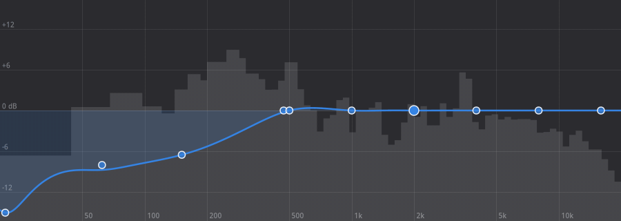

# Dolbro™ Speaker Tuner

**Get the most out of your shitty laptop speakers, or finely tune your audiophilic soundsystem.**

Speaker Tuner is a system-wide EQ, crossover and speaker tuner for Linux
desktops running PipeWire. It adds a virtual output, **Speaker Tuner**, in
front of any sound device, from a laptop's built-in speakers to a stereo pair
with a sub or a full 7.1 setup, and every app plays through it.




## Features

- **An EQ you can draw:** sweep across the graph in either direction to paint
  the curve, or drag individual points. The curve passes through your points
  (the app works out the filter gains for you), and you can scroll to make a
  band wider or narrower or type exact frequency, gain and width values. A
  **live spectrum** of what's playing is drawn behind the curve.
- **Per-channel routing and crossovers for any layout** (2.0, 2.1, 4.0, 5.1,
  7.1, …). For each speaker channel you set:
  - the source: same channel, left, right, mono, all channels (for a sub) or off
  - high-pass and low-pass crossover filters (Linkwitz-Riley, 24 dB/oct)
  - level, delay (for time alignment) and polarity
- **One-click channel setups:** low cut for small speakers, a left-bass /
  right-treble split for laptops, stereo to all speakers, and 80 Hz bass
  management for systems with a subwoofer.
- **Loudness:** up to +20 dB of boost into a look-ahead limiter (ZaMaximX2),
  plus optional **overdrive** for when you want it louder than clean allows.
- **3D:** stereo width plus crosstalk cancellation in the style of
  Ambiophonics/RACE, which spreads sound wider than closely spaced speakers
  such as a laptop's.
- **Presets:** a list at the top of the window. Click one to load it, or save the
  current sound as a new one. Changes save into the active preset as you go.

## How it compares to Easy Effects, JamesDSP, etc.

- **Nothing to keep running:** processing runs inside PipeWire itself. Close
  the app and your sound stays tuned from login onward.
- **True multichannel:** 5.1 stays 5.1, with per-channel crossovers, delays
  and bass management.
- **No dropouts:** changes apply to the running filter live.
- **Tiny:** one Python file and one readable PipeWire config.

## Install

```sh
git clone https://github.com/pjamessteven/dolbro-speaker-tuner.git
cd dolbro-speaker-tuner
./install.sh
```

The script installs any missing dependencies with your package manager (dnf,
apt or pacman). It shows the exact command and asks before using `sudo`. It
then installs the app for your user only.

Open **Speaker Tuner**, pick your output device, and click **Load** in the
banner. Audio restarts once to load the filter.

| Option | What it does |
|---|---|
| `--yes` | install dependencies without asking |
| `--no-deps` | skip dependencies, install the app only |
| `--dry-run` | show what would be installed, change nothing |
| `--uninstall` | remove the app and the PipeWire filter (keeps your presets) |

### Dependencies

Installed for you by `install.sh`:

- PipeWire tools: `pw-cli`, `pw-dump`, `pw-record` and `pactl`
- Python 3 with GTK 4 and libadwaita 1.5+
- The ZaMaximX2 limiter from [zam-plugins](https://github.com/zamaudio/zam-plugins)
- PipeWire's LV2 support for filter-chain

You need a desktop already running PipeWire with WirePlumber, which is the
default on current Fedora, Ubuntu, Debian and Arch. The Fedora package names
are tested; on other distros, if a package name has changed, the script tells
you what's missing so you can install it yourself.

## How it works

```
per input channel:   width (FL/FR) → 10-band EQ → 3D crosstalk cancellation (FL/FR)
per output channel:  source mix → high-pass → low-pass → level/polarity → delay
                     → limiter → overdrive → device channel
```

The graph's layout depends only on the device's channels. Everything else is
a parameter, and turning a feature off sets it to a neutral value, such as
0 dB or a filter moved outside the audible range.

The 3D effect is RACE unrolled to two terms:
`out = own − g·D(other) + g²·D₂(own)`, band-limited to 250 Hz–5 kHz. PipeWire's
filter graphs can't contain feedback loops, so it isn't fully recursive.

The spectrum is read with `pw-record` from the device you're tuning, and only
while the window is open.

## Tips

- **Laptops:** apply the *Small speakers* setup (120 Hz low cut) and add
  6–10 dB of boost. That's roughly what Windows enhancements such as Dolby do
  on most laptops.
- **Subwoofer:** apply *Bass management (80 Hz)*, then fine-tune the
  subwoofer's level and delay until bass sounds even at your seat.
- **3D:** sit centred, set 3D amount to about 70%, then move 3D delay until the
  sound spreads wider than the speakers.
- **Overdrive** sends clipped audio to your speakers. Use it sparingly on small
  drivers.

## License

MIT. See [LICENSE](LICENSE).
