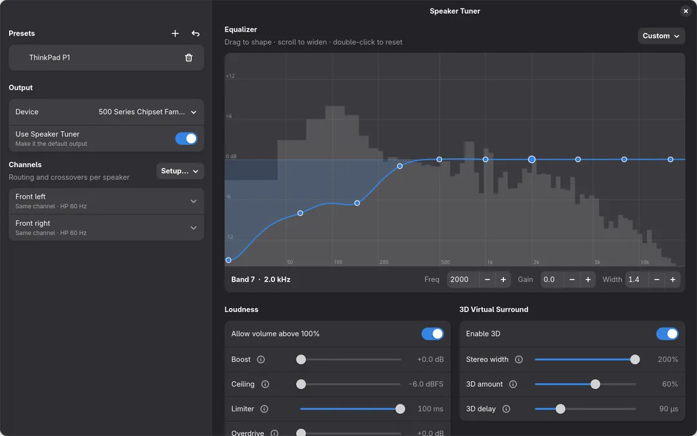
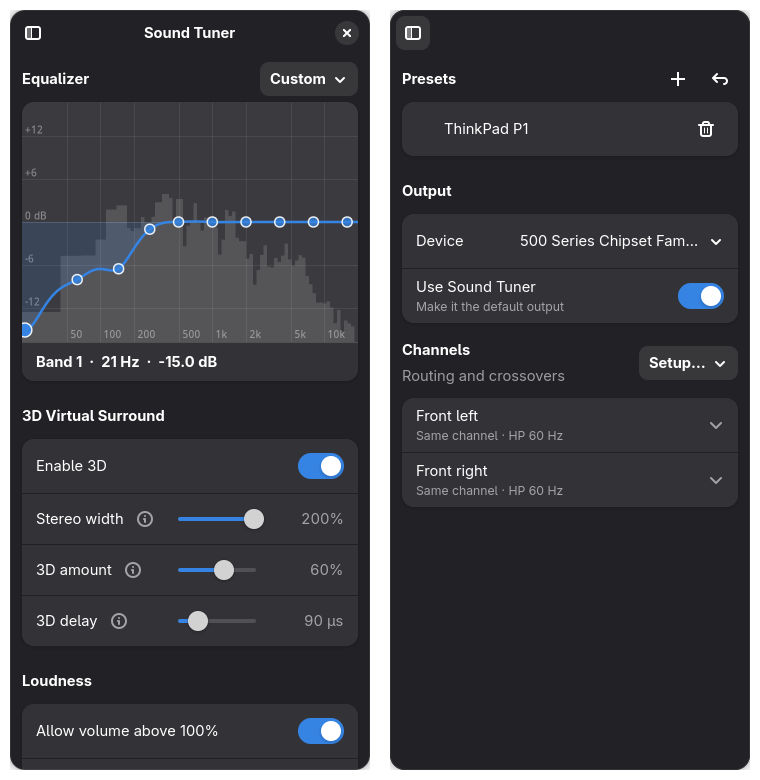

<div dir="rtl">

<p align="center">
  
</p>

<h1 align="center">Dolbro™ Sound Tuner</h1>

<p align="center"><b>اعصر آخر قطرة من سماعات لابتوبك المتواضعة، أو اضبط نظامك الصوتي الفاخر بدقة متناهية.</b></p>

<!-- languages -->
<p align="center"><sub><a href="../README.md">English</a> · <b>العربية</b> · <a href="README.bn.md">বাংলা</a> · <a href="README.cs.md">Čeština</a> · <a href="README.da.md">Dansk</a> · <a href="README.de.md">Deutsch</a> · <a href="README.el.md">Ελληνικά</a> · <a href="README.es.md">Español</a> · <a href="README.fa.md">فارسی</a> · <a href="README.fi.md">Suomi</a> · <a href="README.fr.md">Français</a> · <a href="README.he.md">עברית</a> · <a href="README.hi.md">हिन्दी</a> · <a href="README.hu.md">Magyar</a> · <a href="README.id.md">Bahasa Indonesia</a> · <a href="README.it.md">Italiano</a> · <a href="README.ja.md">日本語</a> · <a href="README.ko.md">한국어</a> · <a href="README.nb.md">Norsk bokmål</a> · <a href="README.nl.md">Nederlands</a> · <a href="README.pl.md">Polski</a> · <a href="README.pt_BR.md">Português (Brasil)</a> · <a href="README.ro.md">Română</a> · <a href="README.ru.md">Русский</a> · <a href="README.sv.md">Svenska</a> · <a href="README.th.md">ไทย</a> · <a href="README.tr.md">Türkçe</a> · <a href="README.uk.md">Українська</a> · <a href="README.vi.md">Tiếng Việt</a> · <a href="README.zh_CN.md">简体中文</a> · <a href="README.zh_TW.md">繁體中文</a></sub></p>
<!-- /languages -->


‏Sound Tuner هو معادل صوت (EQ) ومرشح فصل (crossover) وأداة ضبط لمكبرات الصوت على مستوى النظام
لأسطح مكتب لينكس التي تعمل بـ PipeWire. يضيف مخرجًا افتراضيًا اسمه **Sound Tuner**
أمام أي جهاز صوت، من مكبرات الصوت المدمجة في اللابتوب إلى زوج ستيريو
مع مضخم جهير أو نظام 7.1 كامل، وكل التطبيقات تُشغَّل من خلاله.



على الهواتف والنوافذ الضيقة تنتقل الإعدادات إلى لوحة منزلقة:



## الميزات

- **معادل ترسمه بيدك:** مرّر عبر الرسم البياني في أي اتجاه لترسم
  المنحنى، أو اسحب النقاط واحدة واحدة. يمر المنحنى عبر نقاطك
  (يحسب التطبيق كسب المرشحات نيابةً عنك)، ويمكنك التمرير لجعل
  النطاق أعرض أو أضيق، أو كتابة قيم دقيقة للتردد والكسب والعرض.
  يُرسم **طيف حي** لما يُشغَّل خلف المنحنى.
- **توجيه ومرشحات فصل لكل قناة ولأي تخطيط** (2.0، 2.1، 4.0، 5.1،
  7.1، …). لكل قناة مكبر صوت تضبط:
  - المصدر: القناة نفسها، اليسار، اليمين، أحادي، كل القنوات (لمضخم الجهير) أو معطّل
  - مرشحات فصل تمرير عالٍ وتمرير منخفض (Linkwitz-Riley، 24 dB/أوكتاف)
  - المستوى والتأخير (للمواءمة الزمنية) والقطبية
- **إعدادات قنوات بنقرة واحدة:** قطع منخفض لمكبرات الصوت الصغيرة، وتقسيم جهير يسار /
  حادّ يمين للابتوبات، وستيريو لكل مكبرات الصوت، وإدارة جهير عند 80 Hz
  للأنظمة التي فيها مضخم جهير.
- **الجهارة:** تعزيز حتى +20 dB يدخل إلى محدِّد استباقي (ZaMaximX2)،
  مع **تشبع** اختياري حين تريد صوتًا أعلى مما يسمح به الصوت النظيف،
  ومفتاح يسمح لشريط مستوى الصوت في GNOME بتجاوز 100%.
- **‏3D:** عرض ستيريو مع إلغاء التداخل بأسلوب
  Ambiophonics/RACE، ما ينشر الصوت أوسع من مكبرات الصوت المتقاربة
  مثل مكبرات اللابتوب.
- **الإعدادات المسبقة:** قائمة في أعلى النافذة. انقر على أحدها لتحميله، أو احفظ
  الصوت الحالي كإعداد جديد. تُحفظ التغييرات في الإعداد المسبق النشط أولًا بأول.

## كيف يقارن بـ Easy Effects وJamesDSP وغيرهما

- **واجهة عصرية وسهلة:** شاشة واحدة نظيفة. ارسم منحنى المعادل، واضبط الجهارة
  و3D، واختر إعدادًا مسبقًا، دون التنقيب في لوحات الإضافات. وهي
  مناسبة للهواتف أيضًا، تتكيف من الهواتف حتى شاشات سطح المكتب العريضة.
- **لا شيء يجب أن يبقى قيد التشغيل:** المعالجة تجري داخل PipeWire نفسه. أغلق
  التطبيق ويبقى صوتك مضبوطًا منذ تسجيل الدخول.
- **تعدد قنوات حقيقي:** يبقى 5.1 هو 5.1، مع مرشحات فصل وتأخير
  وإدارة جهير لكل قناة.
- **بلا انقطاعات:** تُطبَّق التغييرات على المرشح العامل مباشرةً.
- **صغير جدًا:** ملف Python واحد وملف إعداد PipeWire واحد سهل القراءة.
- **يصعب أن يتشوه:** تنتهي السلسلة دائمًا بمحدِّد استباقي. انظر أدناه.

### لماذا قد يبدو صوت تطبيقات المعادل الأخرى مشوهًا

يمكن للمعادل وتعزيز الجهير أن يدفعا الإشارة فوق 0 dBFS، وهو أقصى ما تستطيع شريحة الصوت
تشغيله، فيحدث القطع (clipping) ما لم يلتقطها محدِّد. ينتهي Sound Tuner دائمًا
بمحدِّد استباقي مضبوط تحت 0 dBFS، فيصبح التعزيز أعلى صوتًا بدلًا من أن
يطقطق. (التشبع يتجاوز هذا عمدًا.) كما أن معالجته تجري
داخل PipeWire نفسه وليس في عملية تطبيق منفصلة، فيكون هناك برنامج
أقل يجب أن يواكب الزمن الحقيقي.

## التثبيت

```sh
git clone https://github.com/pjamessteven/dolbro-sound-tuner.git
cd dolbro-sound-tuner
./install.sh
```

يثبّت السكربت أي اعتماديات ناقصة بمدير الحزم لديك (dnf أو
apt أو pacman). يعرض الأمر بالضبط ويسألك قبل استخدام `sudo`. ثم
يثبّت التطبيق لمستخدمك فقط.

افتح **Sound Tuner**، واختر جهاز المخرج، وانقر على **تحميل** في
الشريط. يُعاد تشغيل الصوت مرة واحدة لتحميل المرشح.

| الخيار | ماذا يفعل |
|---|---|
| `--yes` | يثبّت الاعتماديات دون سؤال |
| `--no-deps` | يتخطى الاعتماديات ويثبّت التطبيق فقط |
| `--dry-run` | يعرض ما سيُثبَّت دون تغيير أي شيء |
| `--uninstall` | يزيل التطبيق ومرشح PipeWire (مع الإبقاء على إعداداتك المسبقة) |

### الاعتماديات

يثبّتها `install.sh` نيابةً عنك:

- أدوات PipeWire: `pw-cli` و`pw-dump` و`pw-record` و`pactl`
- ‏Python 3 مع GTK 4 وlibadwaita 1.5+
- المحدِّد ZaMaximX2 من [zam-plugins](https://github.com/zamaudio/zam-plugins)
- دعم LV2 في PipeWire لـ filter-chain

تحتاج إلى سطح مكتب يعمل أصلًا بـ PipeWire مع WirePlumber، وهو
الافتراضي في الإصدارات الحالية من Fedora وUbuntu وDebian وArch. أسماء حزم Fedora
مُختبرة؛ أما في التوزيعات الأخرى، فإذا تغيّر اسم حزمة، يخبرك السكربت
بما ينقص لتثبّته بنفسك.

## كيف يعمل

```
per input channel:   width (FL/FR) → 10-band EQ → 3D crosstalk cancellation (FL/FR)
per output channel:  source mix → high-pass → low-pass → level/polarity → delay
                     → limiter → overdrive → device channel
```

يعتمد تخطيط المخطط على قنوات الجهاز فقط. كل ما عدا ذلك
معامل، وإيقاف أي ميزة يضبطها على قيمة محايدة، مثل
0 dB أو مرشح منقول خارج النطاق المسموع.

تأثير 3D هو RACE مفكوكًا إلى حدّين:
`out = own − g·D(other) + g²·D₂(own)`، ومحصورًا في النطاق 250 Hz–5 kHz. لا يمكن
لمخططات المرشحات في PipeWire أن تحتوي على حلقات تغذية راجعة، لذلك فهو ليس تكراريًا بالكامل.

يُقرأ الطيف بواسطة `pw-record` من الجهاز الذي تضبطه، وفقط
أثناء فتح النافذة.

## نصائح

- **اللابتوبات:** طبّق إعداد *مكبرات صوت صغيرة* (قطع منخفض 120 Hz) وأضف
  6–10 dB من التعزيز. هذا تقريبًا ما تفعله تحسينات Windows مثل Dolby
  في معظم اللابتوبات.
- **مضخم الجهير:** طبّق *إدارة الجهير (80 Hz)*، ثم اضبط بدقة
  مستوى مضخم الجهير وتأخيره حتى يبدو الجهير متوازنًا في مكان جلوسك.
- **‏3D:** اجلس في المنتصف، واضبط مقدار 3D على نحو 70%، ثم حرّك تأخير 3D حتى
  ينتشر الصوت أوسع من مكبرات الصوت.
- **التشبع** يرسل صوتًا مقطوعًا إلى مكبرات الصوت. استخدمه باعتدال مع
  المكبرات الصغيرة.

## الترخيص

MIT. انظر [LICENSE](../LICENSE).

</div>
